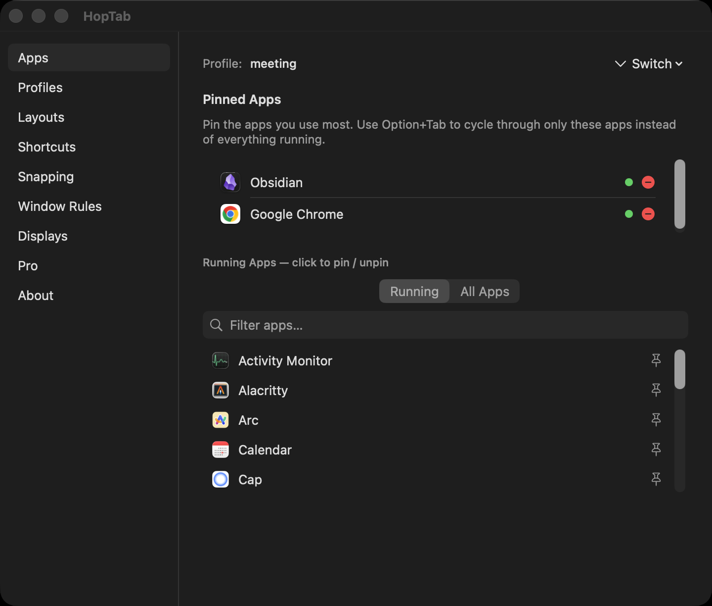
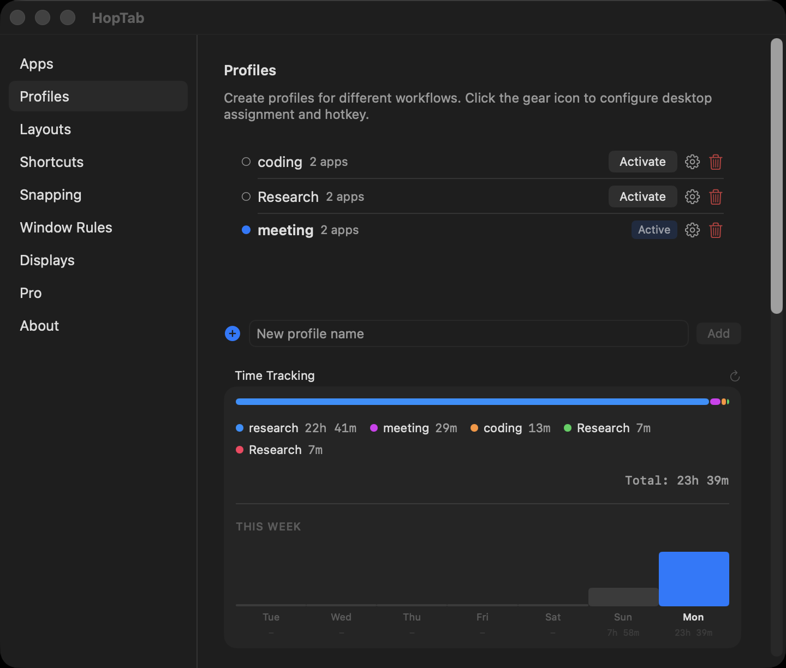
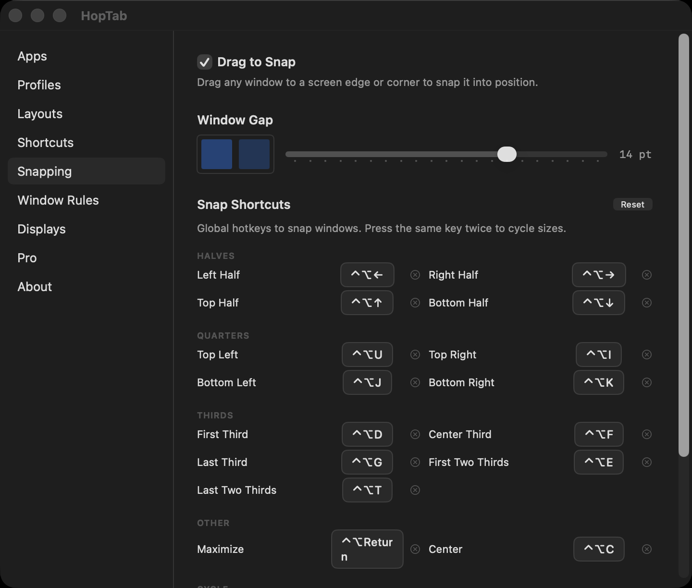
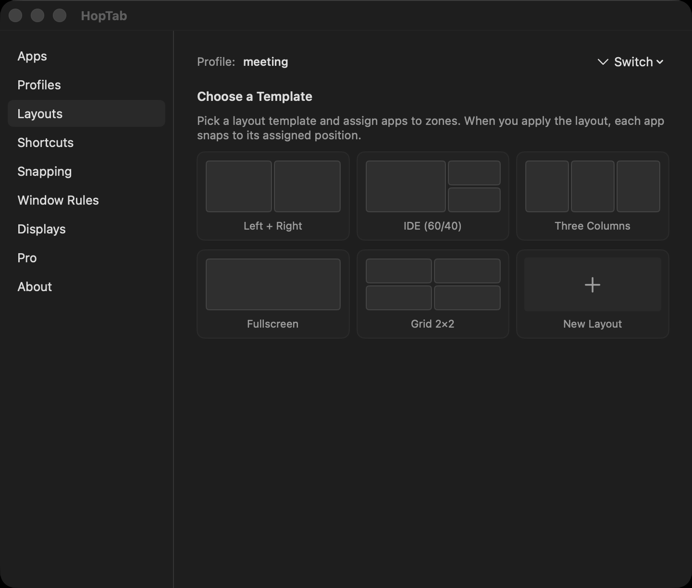
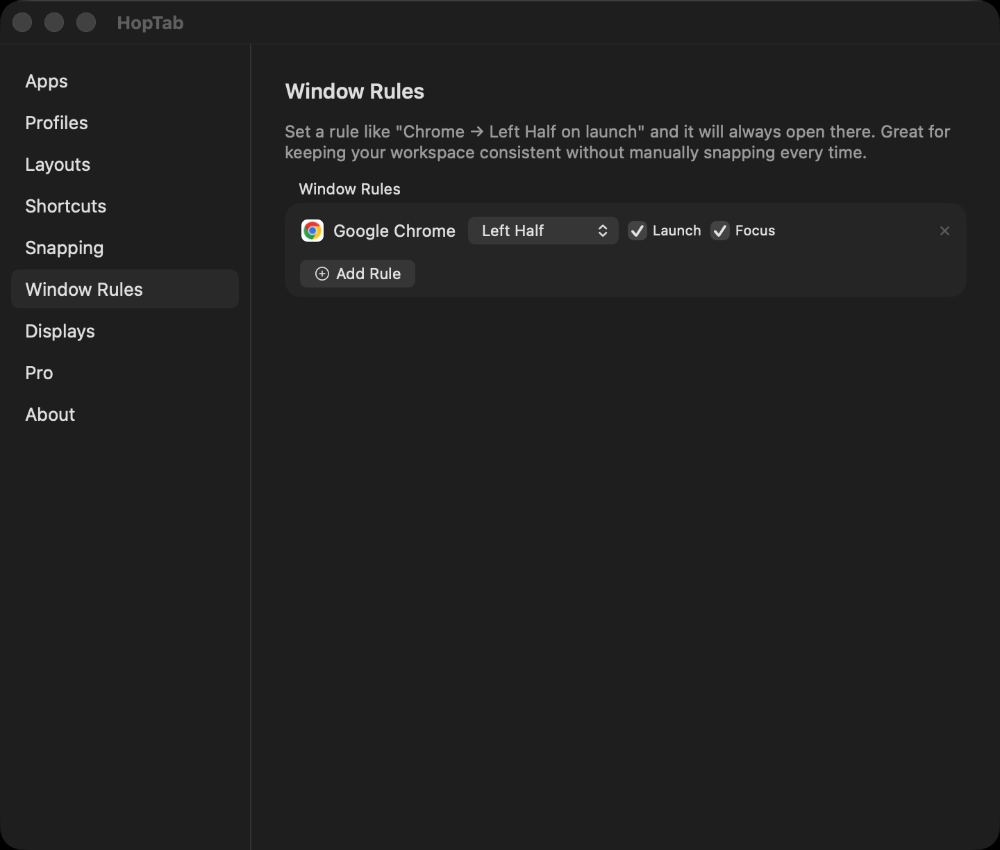
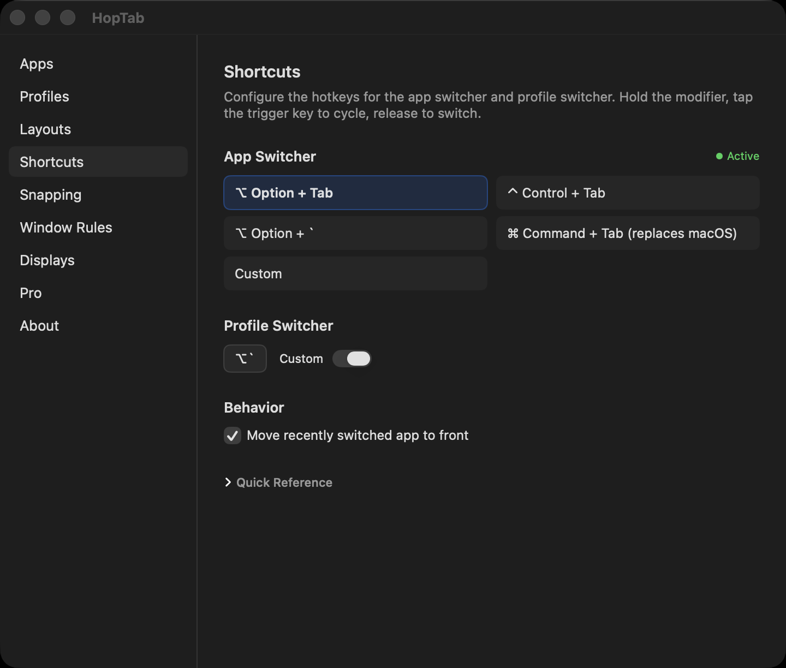
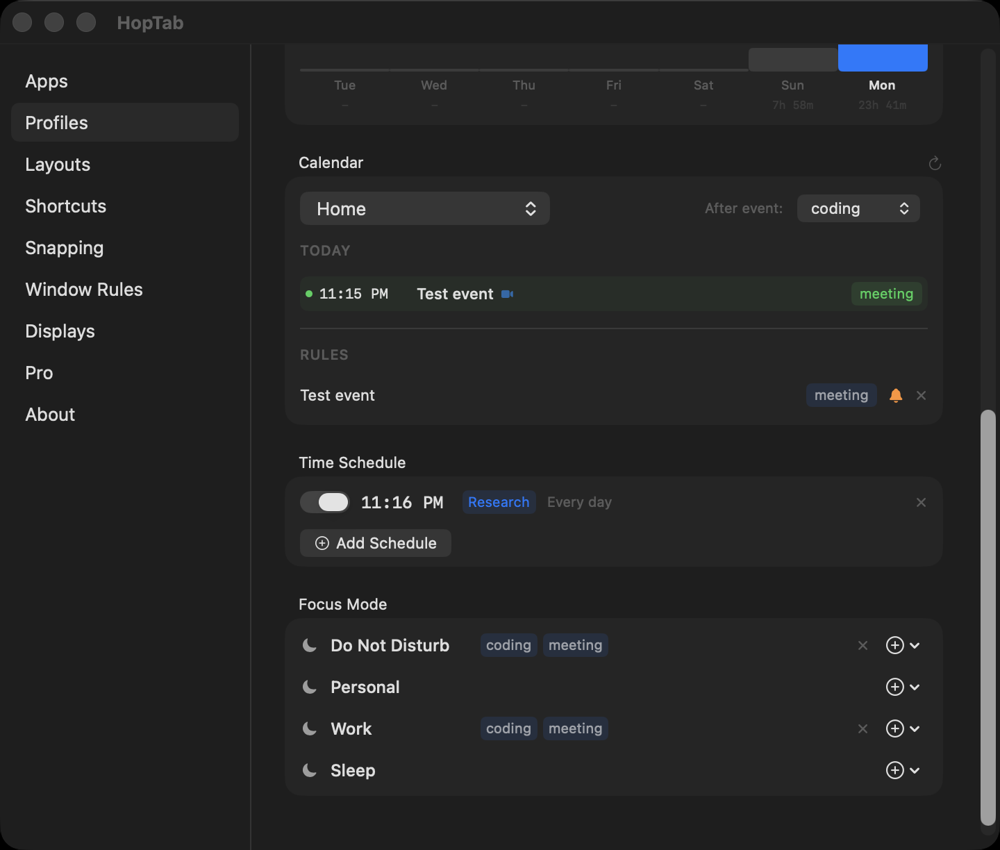

# HopTab

**The workspace manager macOS should've shipped with.**

`⌘Tab` shows every running app, your workspace's first. `⌥Tab` cycles just the workspace you're in. Press `P` in either to pin an app to that workspace, `N` to start a new one with it. One keystroke later your whole setup — apps, windows, layout — is where you left it. Free and open source; [HopTab Pro](#hoptab-pro) makes the switching automatic for [$5 one-time](https://buy.polar.sh/polar_cl_iKgZQ7w4AWRhnNzsnQBl80syKnFJGHJj1Pv6d2a9tD7).


[](https://discord.gg/6pSMtzBGUr)


[](https://www.youtube.com/watch?v=m5ZpmPWk_kM)

> Click the image to watch the full demo on YouTube

## Install

### Homebrew (recommended)

```bash
brew tap royalbhati/tap
brew install --cask hoptab
```

### Manual

1. Download the latest **HopTab-x.y.z.zip** from [Releases](../../releases/latest)
2. Unzip it
3. Drag **HopTab.app** into your **Applications** folder

Or from the terminal:

```bash
curl -sL "$(curl -s https://api.github.com/repos/royalbhati/HopTab/releases/latest \
  | grep -o '"browser_download_url": *"[^"]*"' \
  | head -1 | cut -d '"' -f 4)" -o /tmp/HopTab.zip \
  && unzip -o /tmp/HopTab.zip -d /Applications
```

> **Signed and notarized.** HopTab is signed with an Apple Developer ID certificate
> (Team `GP4Y23ZTR6`) and notarized by Apple, so it opens normally on first launch.
> You do not need to clear the quarantine flag, right-click → Open, or change any
> security setting. If macOS ever refuses to open it, the download is damaged or
> tampered with — re-download it rather than working around Gatekeeper.
>
> Verify a download against the SHA-256 published in the release notes:
> ```bash
> shasum -a 256 HopTab-x.y.z.zip
> ```

### First Launch

1. Grant **Accessibility** permission when prompted
2. HopTab builds your first workspace from the apps already running
3. Press **⌘Tab** for every app, or **⌥Tab** for just that workspace

## Features

### Two Switchers

**`⌘Tab`, all apps.** HopTab replaces the macOS switcher. Your workspace's apps come first, every other running app follows in most-recently-used order. This is where you build workspaces: `P` pins the highlighted app to the current one, `1`–`9` to any, `N` creates a new workspace with it, `⌫` unpins. The icon slides between groups. You never open Settings for this.

**`⌥Tab`, this workspace.** Cycles only the apps in the workspace you're in. Nothing else on the list, nothing to scan past.

In both: `Space` drills into the app's windows, `⌘Q` / `⌘H` / `⌘M` quit, hide or minimize it, arrow keys snap it. Prefer the native `⌘Tab`? Leave "Replace ⌘Tab" off and only `⌥Tab` is HopTab's.



### Workspaces

A workspace (profile) is a named set of apps with its own layout, hotkey, desktop and saved window session. `⌥` + `` ` `` switches between them; release and HopTab launches what's missing, applies the layout, moves to the right Space. The menu bar lists every workspace with its icons — one click to switch, one click to make a new one from whatever is open right now.

3 workspaces free, unlimited with Pro.



### Window Tiling

Global keyboard shortcuts snap any window to halves, thirds, quarters, or fullscreen. Works anytime — no switcher needed.

Press the same direction again to cycle sizes: **1/2 → 1/3 → 2/3**. Undo any snap with one shortcut.



### Drag-to-Snap

Drag any window to a screen edge or corner and a translucent preview overlay shows where it will land. Release to snap.

- **Edges:** left/right half, top to maximize, bottom for bottom half
- **Corners:** quarter snap (top-left, top-right, bottom-left, bottom-right)
- Works with all apps. Toggle on/off in Settings → Snapping. Enabled by default.

### Layout Templates

Five built-in layouts: 50/50 split, IDE 60/40, three columns, 2×2 grid, and fullscreen. Assign apps to zones and apply with one click.

Works with stubborn apps — Chrome, Zed, Wezterm, Electron. Multi-retry positioning with dual strategies for GPU-rendered windows.



### Session Management

Save every window's position, size, and z-order per profile. Restore it instantly. Close everything, come back tomorrow, pick up exactly where you left off.

### Window Rules

Define rules like "Chrome always snaps to left half on launch." Free tier includes 2 window rules; Pro unlocks unlimited.



### Fully Customizable

Every shortcut is configurable: the switcher key, the workspace key, every snap direction, per-workspace hotkeys. The everyday snaps show first; sixths, ninths and move-to-edge sit under "Rectangle extras" and import straight from a Rectangle setup.



## HopTab Pro

Everything above is free. **HopTab Pro** ($5 one-time via [Polar](https://buy.polar.sh/polar_cl_iKgZQ7w4AWRhnNzsnQBl80syKnFJGHJj1Pv6d2a9tD7), or [GitHub Sponsors](https://github.com/sponsors/royalbhati)) does one thing: **it switches your workspace for you.**



| Trigger | What happens |
|---|---|
| **Calendar** | "Daily Standup" starts → Meeting workspace. Detects Zoom / Teams / Meet links, fullscreen reminder with a Join button. |
| **Time of day** | "7 PM → Entertainment", with day-of-week filters. |
| **macOS Focus mode** | Turn on "Work" Focus → Work workspace. |
| **Displays** | Dock the laptop → Desk workspace. Undock → Laptop workspace. |
| **App launch / focus** | Window rules: "Chrome always left 60%". Free has 2, Pro unlimited. |

Pro also removes the 3-workspace limit, unlocks custom layouts with exact zone percentages, and adds multi-level window undo.

### Labs (experimental, off by default)

Included with Pro but not the product. Clearly marked in Settings → Automation → Labs: BSP auto-tiling.

> **Student or can't afford it?** Email rawyelll@gmail.com for a free Pro key. No questions asked.

## Pricing

| | Free | Pro |
|--|------|-----|
| **Price** | Free & open source | $5 one-time via [Polar](https://buy.polar.sh/polar_cl_iKgZQ7w4AWRhnNzsnQBl80syKnFJGHJj1Pv6d2a9tD7) or [GitHub Sponsors](https://github.com/sponsors/royalbhati) |
| ⌘Tab / ⌥Tab switcher with in-switcher pinning | Yes | Yes |
| Workspaces (profiles) | 3 | Unlimited |
| Window tiling, drag-to-snap, size cycling, undo | Yes | Yes |
| Move between monitors | Yes | Yes |
| Layout templates (5 built-in) | Yes | Yes |
| Session save/restore | Yes | Yes |
| Window rules | 2 | Unlimited |
| Custom layouts (exact %) | — | Yes |
| Calendar auto-switch | — | Yes |
| Time-based scheduling | — | Yes |
| Focus mode integration | — | Yes |
| Display auto-profiles | — | Yes |
| Multi-level window undo | — | Yes |
| Labs (time tracking, Pomodoro, tiling, dimming, …) | — | Experimental |

## Keyboard Shortcuts

### App Switcher

| Action | Shortcut |
|--------|----------|
| All running apps, workspace first | `⌘` + `Tab` (turn on "Replace ⌘Tab" in Settings or onboarding) |
| Only this workspace's apps | `Option` + `Tab` (configurable) |
| Cycle backward | `Shift` + the same combo |
| Switch to selected | Release the modifier |
| Cancel | `Escape` |

### While Switcher Open

| Action | Shortcut |
|--------|----------|
| Pin / unpin highlighted app in current workspace | `P` |
| Toggle it in workspace 1–9 | `1` … `9` |
| New workspace containing it | `N` |
| Unpin from current workspace | `⌫` |
| Show the app's windows | `Space` |
| Quit / Hide / Minimize | `Cmd+Q` / `Cmd+H` / `Cmd+M` |
| Snap left / right / top / bottom | `←` `→` `↑` `↓` |

### Global Window Tiling

| Action | Shortcut |
|--------|----------|
| Left / Right / Top / Bottom half | `Ctrl+Opt` + `←` `→` `↑` `↓` |
| Quarters (TL / TR / BL / BR) | `Ctrl+Opt` + `U` `I` `J` `K` |
| First / Center / Last third | `Ctrl+Opt` + `D` `F` `G` |
| First / Last two-thirds | `Ctrl+Opt` + `E` `T` |
| Maximize | `Ctrl+Opt` + `Return` |
| Center | `Ctrl+Opt` + `C` |
| Undo snap | `Ctrl+Opt` + `Z` |

### Drag-to-Snap (Mouse)

| Action | Gesture |
|--------|---------|
| Left / Right half | Drag to left / right edge |
| Maximize | Drag to top edge |
| Bottom half | Drag to bottom edge |
| Quarter snap | Drag to any corner |

A translucent preview overlay appears at the target zone. Toggle in Settings → Snapping.

### Monitors

| Action | Shortcut |
|--------|----------|
| Next monitor | `Ctrl+Opt+Cmd` + `→` |
| Previous monitor | `Ctrl+Opt+Cmd` + `←` |

### Profiles

| Action | Shortcut |
|--------|----------|
| Switch profile | `Option` + `` ` `` |
| Cycle backward | `Shift` + `Option` + `` ` `` |

All shortcuts are fully configurable in Settings → Shortcuts.

## Example Workflow

| Profile | Pinned Apps | Desktop | Hotkey |
|---------|------------|---------|--------|
| Coding | Zed, Wezterm, Chrome, TablePlus | Desktop 1 | `Ctrl+1` |
| Design | Figma, Safari, Preview | Desktop 2 | `Ctrl+2` |
| Research | Chrome, Notion, Obsidian | Desktop 3 | `Ctrl+3` |

Swipe to Desktop 1 → workspace auto-switches → `⌘Tab` shows Zed, Wezterm, Chrome, TablePlus first, everything else after.

Press `Ctrl+3` → session saved, Research profile restored with all windows back in position.

## Build from Source

Requires **Xcode 15+** and **macOS 14+**.

```bash
git clone https://github.com/royalbhati/HopTab.git
cd HopTab
bash scripts/generate-pro-stub.sh   # required — see below
open HopTab.xcodeproj
# Cmd+R to build and run
```

### About the HopTabPro stub

Everything in the free tier is in this repository. **HopTab Pro is closed source**
and lives in a separate private repo, so the `HopTabPro/` Swift package that
`HopTab.xcodeproj` references is not checked in here.

`scripts/generate-pro-stub.sh` writes a compile-only stub package in its place.
The stub matches the real module's public API but every entry point is inert
(`isLicensed` is always `false`, services never start, Pro settings sections
render a short "not available in this build" notice), so the open-source build
produces a fully working **free-tier** app with Pro disabled.

- Run it once after cloning. CI runs it automatically before every `xcodebuild`.
- It **never overwrites** an existing `HopTabPro/` directory — if you have the
  real private package checked out, the script exits without touching anything.
- The generated directory stays gitignored.

Without this step the build fails with `The folder "HopTabPro" doesn't exist.`

### Signing

Release builds are signed with an Apple Developer ID certificate (Team
`GP4Y23ZTR6`), built with the hardened runtime, notarized by Apple and stapled —
see `.github/workflows/release.yml`, which fails the build rather than publishing
an unsigned or unnotarized app.

Entitlements live in [`HopTab/HopTab.entitlements`](HopTab/HopTab.entitlements)
(calendar access only, for Pro's calendar auto-switch; HopTab is deliberately
**not** sandboxed because `CGEvent.tapCreate` and the Accessibility APIs are
unavailable inside the App Sandbox).

> **Known drift:** `HopTab.xcodeproj` still has `CODE_SIGN_ENTITLEMENTS = ""` and
> `CODE_SIGN_STYLE = Automatic`. The release workflow passes the entitlements file
> and manual signing on the `xcodebuild` command line to compensate. The project
> setting should be pointed at `HopTab/HopTab.entitlements` so local and CI builds
> agree.

## Technical Notes

- **CGEvent tap** to intercept global shortcuts (session-level, head-insert)
- **AXUIElement API** for window positioning with multi-retry and dual strategies
- **AXEnhancedUserInterface** enabled before window queries (fixes Chrome, Electron, Zed)
- **NSPanel** non-activating overlay at `.screenSaver` level
- **Sidebar settings** — four panes: Workspaces, Shortcuts, Pro, General
- **No App Sandbox** — required for `CGEvent.tapCreate`
- **CGSGetActiveSpace** private API for desktop-to-profile mapping
- **Cycle tracker** — same-direction snaps within 1.5s cycle through sizes
- **Undo stack** — per-window frame saved before each snap

## Community

- [Discord](https://discord.gg/6pSMtzBGUr) — feature requests, support, feedback
- [GitHub Issues](https://github.com/royalbhati/HopTab/issues) — bug reports
- [Website](https://www.royalbhati.com/hoptab) — docs and download

## License

MIT. See [LICENSE](LICENSE).
